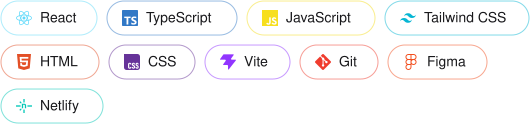

<!-- The cartoon from my original profile -->

  

<h1 align="center">Hi, I'm Ramesh 👋</h1>
<h3 align="center">Front-end Developer · Oslo, Norway</h3>

  <b>I build for the web.</b> I love building responsive, accessible websites with React, TypeScript and Tailwind CSS, with real care for the user experience.

  
  
  

---

### 🛠️ Tech I use

<!-- Same chips as the portfolio: real logos with thin logo-coloured borders -->

  

