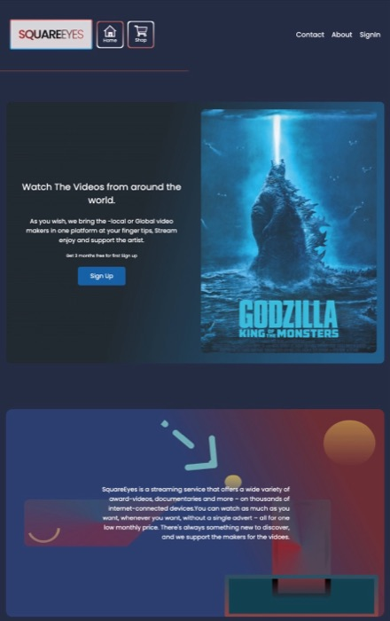
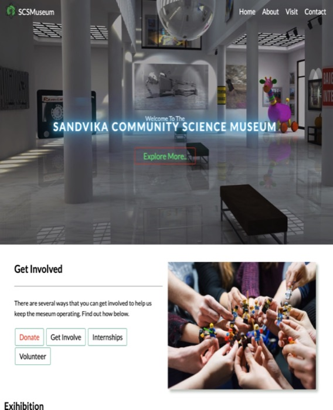
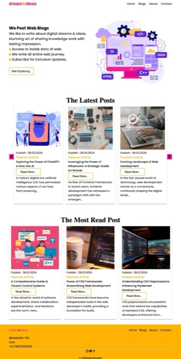

<!-- The cartoon from my original profile -->

  

<h1 align="center">Hi, I'm Ramesh 👋</h1>
<h3 align="center">Front-end Developer · Oslo, Norway · I build for the web.</h3>

  I love building responsive, accessible websites with React, TypeScript and Tailwind CSS, 
  with real care for the user experience.

  
  
  

---

### 👨‍🍳 About me

My path into code wasn't a straight line. It started in **Kathmandu** with a bachelor's degree in media technology, where I learned how design, media and technology come together to tell a story on screen.

Then I moved to **Oslo** and trained as a chef at **Hotel Bristol**. The kitchen taught me things no classroom could: work clean, plan every step, keep calm under pressure and deliver on time — every single service.

Front-end development at **Noroff** brought it all together. Today I mix a designer's eye with a chef's discipline to build fast, accessible websites.

**Now I'm taking on freelance projects.** Need a new website, a landing page or a fresh look for an old one? Let's cook something great together. 🍳

---

### 🛠️ Tech I use

  
  
  
  
  
  
  
  
  
  

---

### 🎓 Education

| Programme | Where |
|---|---|
| **Front-end Development** | Noroff |
| **Diploma in Chef Studies** | Hotel Bristol, Oslo |
| **Bachelor's in Media Technology** | Kathmandu, Nepal |

---

### 🚀 Things I've built

<table>
  <tr>
    <td width="33%" valign="top">
      
      <h4>SquareEyes</h4>
      
A movie streaming website where visitors browse films and pick something to watch.

      <a href="https://squareeye.netlify.app/">Live site</a> · <a href="https://github.com/codeitR/caschool">Code</a>
    </td>
    <td width="33%" valign="top">
      
      <h4>Community Science Museum</h4>
      
An engaging, fully responsive museum website that encourages people to visit.

      <a href="https://quiet-stardust-3c2672.netlify.app/">Live site</a> · <a href="https://github.com/codeitR/codeca">Code</a>
    </td>
    <td width="33%" valign="top">
      
      <h4>Dream &amp; Ideas</h4>
      
A blog for writers and tech enthusiasts. My first project exam at Noroff.

      <a href="https://dreamandideas.netlify.app/">Live site</a> · <a href="https://github.com/Noroff-FEU-Assignments/project-exam-1-codeitR">Code</a>
    </td>
  </tr>
</table>

  <a href="https://codeitr.github.io/portofolio/"><b>See my full portfolio →</b></a>

  

